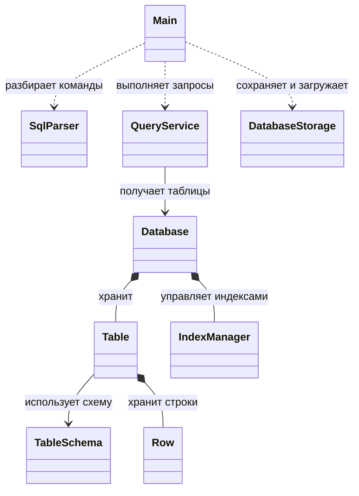
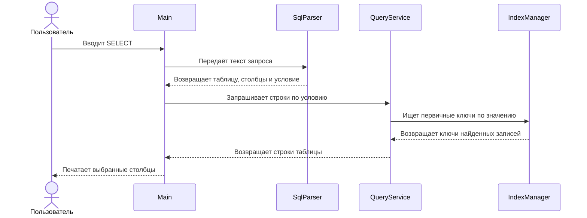

# TelecomDB

Лабораторная работа № 2 для курса по Java. Работу выполнили Бондин Михаил и Таранов Максим, студенты группы 25КНТ-5.

Учебная СУБД на Java для мобильного оператора. В консоли можно добавлять абонентов и платежи, выбирать, изменять и удалять записи, создавать таблицы и индексы. База сохраняется в файл и загружается при следующем запуске.

## Запуск

Нужны JDK 17 или новее и Maven. Выполните команды из папки с `pom.xml`:

```bash
mvn clean package
java -cp target/classes dbms.Main
```

Программа покажет приглашение `telecom>`. Каждую команду вводите на отдельной строке. Для выхода введите `EXIT`. При обычном выходе база сохраняется в `data/telecom.db`, а описания индексов — в `data/telecom.db.idx`. Пути считаются от рабочей папки программы.

## Структура базы

| Таблица | Столбцы |
|---|---|
| `subscribers` | `subscriber_id` — первичный ключ, `full_name`, `phone_number`, `registration_date`, `balance`, `is_active` |
| `payments` | `payment_id` — первичный ключ, `subscriber_id` — внешний ключ, `payment_date`, `amount`, `comment`, `is_confirmed` |

Один абонент может иметь несколько платежей. При добавлении платежа программа проверяет, что абонент с указанным `subscriber_id` уже существует. Поддерживаемые типы данных — `INTEGER`, `DOUBLE`, `STRING`, `DATE` и `BOOLEAN`.

## Примеры команд

Сценарий рассчитан на новую базу. Для проверки существующую базу можно оставить в её папке, а программу запустить из отдельной рабочей папки.

```sql
INSERT INTO subscribers VALUES (1, 'Иван Иванов', '+79990000001', '2026-01-15', 500.0, TRUE);
INSERT INTO payments (payment_id, subscriber_id, payment_date, amount, is_confirmed) VALUES (101, 1, '2026-01-16', 200.0, TRUE), (102, 1, '2026-01-17', 350.0, TRUE);
SELECT * FROM payments;
UPDATE payments SET amount = 450.0, comment = 'Сумма уточнена' WHERE payment_id = 102;
DELETE FROM payments WHERE payment_id = 101;
SELECT payment_id, amount FROM payments WHERE amount >= 400;
CREATE INDEX idx_subscribers_phone ON subscribers (phone_number);
SELECT full_name FROM subscribers WHERE phone_number = '+79990000001';
CREATE TABLE service_plans (plan_id INTEGER PRIMARY KEY, title STRING, price DOUBLE);
INSERT INTO service_plans VALUES (1, 'Базовый', 399.0);
SELECT * FROM service_plans;
DROP TABLE service_plans;
EXIT
```

После `UPDATE` и `DELETE` запрос с `amount >= 400` вернёт платёж `102` на сумму `450.0`. Поиск по телефону выведет имя абонента. После перезапуска `SELECT * FROM payments;` должен снова показать сохранённый платёж.

| Команда | Поддерживаемые варианты |
|---|---|
| `INSERT INTO` | Одна или несколько строк. Можно явно указать столбцы. |
| `SELECT` | Все столбцы через `*` или перечисленные столбцы. |
| `UPDATE` | Одно или несколько присваиваний в `SET`. |
| `DELETE` | Удаление записей по условию. При отсутствии `WHERE` удаляются все строки таблицы с учётом внешних ключей. |
| `CREATE TABLE` | Имена и типы столбцов и один первичный ключ, объявленный после типа столбца. |
| `DROP TABLE` | Удаление таблицы и её индексов. Если на таблицу ссылается другая таблица, ядро отклоняет удаление. |
| `CREATE INDEX` | Индекс по одному столбцу. В ядре он определяется парой «таблица и столбец». |

`WHERE` поддерживает одно условие вида «столбец, оператор, значение». Доступны `=`, `!=`, `>`, `>=`, `<` и `<=`. Для логических столбцов доступны `=` и `!=`. Текст и даты в примерах передаются в одинарных кавычках. При `UPDATE` без `WHERE` меняются все строки таблицы.

## Структура проекта

```text
dbms-java/
├── src/
│   ├── main/
│   │   └── java/
│   │       └── dbms/
│   │           ├── Main.java            # Запуск программы и обработка команд
│   │           ├── TelecomSchema.java   # Таблицы абонентов и платежей
│   │           ├── sql/                 # Парсер и классы SQL-команд
│   │           ├── model/               # Таблицы, строки, столбцы, типы и ключи
│   │           ├── engine/              # Выполнение запросов и проверка связей
│   │           ├── index/               # Создание и обновление индексов, поиск
│   │           └── storage/             # Сохранение и загрузка базы
│   └── test/
│       └── java/
│           └── dbms/                    # Тесты JUnit
├── data/                                # Файлы базы и индексов после сохранения
├── target/                              # Результаты сборки Maven
├── pom.xml                              # Настройки сборки и зависимости
└── README.md                            # Описание и инструкция по запуску
```

## Основные классы

`Main` читает команды и выводит результат. `SqlParser` разбирает запрос. `QueryService` выполняет выборку, изменение и удаление записей. `Database` хранит таблицы и внешние ключи, а `DatabaseStorage` отвечает за файл базы.



### Как выполняется выборка по индексу

Для `SELECT full_name FROM subscribers WHERE phone_number = '...';` с существующим индексом по `phone_number`:



## Сравнение скорости поиска

На 10 000 тестовых абонентах программа ищет один и тот же номер телефона по условию `=`. Сначала поиск идёт перебором, затем создаётся индекс по `phone_number` и тот же поиск повторяется. Перед каждым замером выполняются 50 запросов для прогрева. Время 200 следующих запросов делится на 200, чтобы получить среднее время одного поиска. Код работает с отдельной базой в памяти.

Пример результата на OpenJDK 21:

| Способ поиска | Среднее время запроса, мс | Найдено строк за 200 запросов |
|---|---:|---:|
| Перебор строк | 0,4986 | 200 |
| Поиск по индексу | 0,0078 | 200 |

Время зависит от компьютера и количества записей. В этом замере каждый запрос находил одну строку.

<details>
<summary>Код для проверки</summary>

Сохраните код в файл `IndexBenchmark.java` рядом с `pom.xml`. После сборки запустите:

```bash
java -cp target/classes IndexBenchmark.java
```

```java
import dbms.TelecomSchema;
import dbms.engine.*;
import dbms.model.*;
import java.util.Map;

public class IndexBenchmark {
    public static void main(String[] args) {
        Database db = TelecomSchema.createDatabase();
        Table table = db.getTable("subscribers");

        for (int id = 1; id <= 10_000; id++) {
            db.insertRow("subscribers", new Row(table.getSchema(), Map.of(
                    "subscriber_id", id, "full_name", "Абонент " + id,
                    "phone_number", "phone-" + id, "registration_date", "2026-01-15",
                    "balance", 0.0, "is_active", true
            )));
        }

        QueryService service = new QueryService(db);
        Condition phone = new Condition("phone_number", Condition.Operator.EQUALS, "phone-10000");

        measure("Без индекса", service, phone);
        db.createIndex("subscribers", "phone_number");
        measure("С индексом", service, phone);
    }

    private static void measure(String label, QueryService service, Condition phone) {
        for (int i = 0; i < 50; i++) {
            service.selectRows("subscribers", phone);
        }

        int found = 0;
        long start = System.nanoTime();
        for (int i = 0; i < 200; i++) {
            found += service.selectRows("subscribers", phone).size();
        }
        double averageMs = (System.nanoTime() - start) / 200.0 / 1_000_000;

        System.out.printf("%s: %.4f мс, совпадений за 200 запросов: %d%n",
                label, averageMs, found);
    }
}
```

</details>

## Распределение работы

| Участник | Задачи |
|---|---|
| Михаил Бондин | Модели таблиц и записей, проверки ключей, операции с данными, файловое хранение, индексы и автоматические тесты ядра. |
| Максим Таранов | SQL-парсер, обработка команд в консоли, подключение ядра и проверка работы программы с сохранением и перезапуском. |

## Вывод

TelecomDB выполняет основные операции с записями, проверяет ключи и сохраняет данные между запусками. Индекс по номеру телефона позволяет получать строки по первичным ключам при точном поиске. Ядро обновляет индекс при добавлении, изменении и удалении записей.